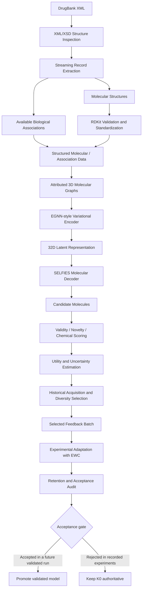

# MyPat — Self-Evolving Molecular Encoder–Decoder for Closed-Loop Drug Discovery

**A research prototype for XML-based molecular data processing,
geometry-aware representation learning, molecular generation,
uncertainty-aware candidate prioritization, and continual-learning
evaluation.**


> **Research status:** MyPat is a computational research prototype. Its recorded experiments demonstrate molecular-data processing, candidate generation, computational scoring, active-learning selection, experimental EWC adaptation, and evidence auditing. They do **not** establish clinical efficacy, experimentally measured binding affinity, a consistent EWC advantage, or successful promotion of an adapted model. The authoritative model remains **K0**.

------------------------------------------------------------------------

## Table of contents

- [Overview](#overview)
- [What MyPat does](#what-mypat-does)
- [Architecture](#architecture)
- [Current recorded results](#current-recorded-results)
- [Project phases](#project-phases)
- [Repository layout](#repository-layout)
- [Requirements](#requirements)
- [Data access and licensing](#data-access-and-licensing)
- [Setup](#setup)
- [Configure the project](#configure-the-project)
- [How to run the notebook safely](#how-to-run-the-notebook-safely)
- [Outputs and artifact naming](#outputs-and-artifact-naming)
- [Reproducibility and integrity](#reproducibility-and-integrity)
- [Scientific limitations](#scientific-limitations)
- [Troubleshooting](#troubleshooting)
- [Responsible use](#responsible-use)
- [License and citation](#license-and-citation)

------------------------------------------------------------------------

## Overview

**MyPat** is a research implementation of a closed-loop molecular-design
workflow. It combines native DrugBank XML processing, chemical
standardization, three-dimensional molecular graph preparation, an
EGNN-style variational encoder, a SELFIES-conditioned molecular decoder,
computational property scoring, uncertainty-aware acquisition, and
experimental continual-learning evaluation with Elastic Weight
Consolidation (EWC).

The project is implemented as a Jupyter notebook with individually
executed phases and saved, provenance-aware outputs. The notebook has
evolved through several correction and audit iterations; its final
phases consolidate historical evidence rather than rerun the full
model-development workflow.

### Core ideas

- **Native XML ingestion:** Process the DrugBank XML source directly,
  without an intermediate relational database requirement.
- **Chemical curation:** Use RDKit to validate and standardize molecular
  structures.
- **Geometry-aware representation:** Represent eligible molecules as
  attributed graphs with atom features, bonds, and 3D coordinates.
- **Latent representation learning:** Encode molecular graphs into a
  32-dimensional latent representation.
- **Molecular generation:** Decode latent samples into SELFIES molecular
  strings.
- **In-silico evaluation:** Calculate chemical scores and model-derived
  biological relevance.
- **Uncertainty-aware prioritization:** Use the implemented acquisition
  policy, including utility/uncertainty and diversity-aware selection.
- **Continual-learning experiments:** Compare experimental adaptation
  branches with and without EWC.
- **Evidence governance:** Preserve K0 and frozen Fisher references,
  audit source hashes, and distinguish measured results from scientific
  claims that remain unverified.

## What MyPat does

| Component                   | Purpose                                                                                     |
|:----------------------------|:--------------------------------------------------------------------------------------------|
| XML/XSD inspection          | Inspect DrugBank source structure and expected fields                                       |
| Streaming extraction        | Extract top-level drug records, molecular structures, and available biological associations |
| Chemical standardization    | Parse, sanitize, standardize, and identify duplicate molecular structures                   |
| Molecular graph preparation | Construct molecular graphs with atom/bond attributes and 3D coordinates                     |
| EGNN-style encoder          | Produce geometry-aware molecular representations                                            |
| Variational latent model    | Learn and sample a 32-dimensional latent representation                                     |
| SELFIES decoder             | Generate candidate molecular strings from latent vectors                                    |
| Scoring engine              | Evaluate QED, SA-related utility, and predicted target relevance                            |
| Acquisition and selection   | Rank candidates using the historical acquisition policy and diversity-aware selection       |
| EWC evaluation              | Measure experimental parameter movement and reference-retention proxies                     |
| Artifact audits             | Reconcile outputs, verify hashes, document limitations, and prepare evidence reports        |

The notebook’s exact scoring definitions are phase-specific. In
particular, an SA-related **utility proxy** must not automatically be
interpreted as a laboratory synthesis result, and predicted biological
relevance is not an experimental assay.

## Architecture



The diagram describes the system’s intended conditional workflow. In the
recorded three-cycle experiments, the adapted branches were **not
accepted**, so the authoritative model remained K0. The diagram must not
be read as evidence that a K1 model was successfully promoted.

## Current recorded results

The figures below are the results recorded in the current notebook and
its final audit outputs. They describe this particular run history, not
guaranteed performance on other datasets or machines.

### Native XML processing — Phase 29

| Metric                          |       Recorded result |
|:--------------------------------|----------------------:|
| XML file size                   |         1,544.664 MiB |
| Top-level DrugBank drug records |                17,430 |
| Small-molecule records          |                13,166 |
| Records with extracted SMILES   |                12,313 |
| Valid standardized records      |                12,303 |
| Unique standardized SMILES      |                11,942 |
| Full XML benchmark repetitions  |                     3 |
| Mean processing time            |      171.8094 seconds |
| Mean throughput                 | 101.47 records/second |
| Mean peak in-kernel RSS         |          1,226.82 MiB |

**Memory caveat:** The reported peak RSS was measured inside the running
Jupyter process. It is not an isolated XML-parser memory measurement.

### Three-cycle molecular generation — Phase 25

| Metric                        | Cycle 1 | Cycle 2 | Cycle 3 |
|:------------------------------|--------:|--------:|--------:|
| Generation attempts           |     320 |     320 |     320 |
| Structurally valid outputs    |     320 |     319 |     320 |
| Within-cycle unique molecules |     313 |     318 |     314 |
| Scored candidates             |     109 |     110 |     109 |
| Selected feedback candidates  |      50 |      50 |      50 |

- **328** scored candidate records across the three cycles.
- **150** feedback-selection records (50 per cycle).
- **934** globally unique generated molecules, after cross-cycle
  duplicate handling.
- **6** experimental adaptation branches across the three cycles and two
  EWC conditions.

The sum of the three within-cycle unique counts is 945; the global
unique count is 934 because some structures occur in more than one
cycle.

### Final evidence status — Phases 30–32

| Phase    | Recorded status                                                  |
|:---------|:-----------------------------------------------------------------|
| Phase 30 | `PASS_FINAL_K0_SYSTEM_METRICS_RETROSPECTIVE_NO_BIOLOGICAL_CLAIM` |
| Phase 31 | `PASS_PHASE31_ARTIFACT_AUDIT_K0_WITH_DOCUMENTED_GAPS`            |
| Phase 32 | `PASS_PHASE32_K0_EVIDENCE_AUDIT_WITH_DOCUMENTED_GAPS`            |

Phase 31 indexed 16 artifact groups: 12 complete and 4 partial. Phase 32
preserved those statuses because 26 supporting files had current
checksums but no earlier eligible local digest match was found. A new
checksum verifies current bytes; it does not prove historical identity.

**Continual-learning conclusion:** The recorded result was
`D_MIXED_OR_NO_CONSISTENT_RETENTION_ADVANTAGE`. Ground-truth
catastrophic forgetting was **not established**, and K0 remained
authoritative.

## Project phases

The notebook groups work into the following stages. Some phase labels
reflect the notebook’s iterative development history; for final audit
lineage, use the saved run IDs, manifests, and output prefixes.

| Phase group       | Main work                                                                                                                                               |
|:------------------|:--------------------------------------------------------------------------------------------------------------------------------------------------------|
| **1–2**           | Environment setup, DrugBank XML/XSD inspection, field mapping                                                                                           |
| **3–6**           | Streaming extraction, intermediate datasets, RDKit standardization, biological association preparation                                                  |
| **7–8**           | 3D molecular graph construction and baseline corpus/split preparation                                                                                   |
| **9–13**          | EGNN-style encoder, variational latent learning, SELFIES decoder, baseline predictor, Fisher reference                                                  |
| **14–16**         | Latent candidate generation, chemical screening, in-silico scoring and uncertainty                                                                      |
| **17–22**         | Feedback adaptation experiments, retention checks, cycle-2 candidate evaluation, acquisition, and dynamic re-encoding                                   |
| **23A–23D / 24A** | Feedback-pair construction, stability–plasticity diagnostics, prospective EWC experiments, read-only checkpoint audits, and historical knowledge ledger |
| **25**            | Three-cycle molecular generation, scoring, selection, and experimental adaptation branches                                                              |
| **26A**           | Retrospective EWC versus no-EWC ablation                                                                                                                |
| **27**            | K0 latent-manifold and experimental embedding-movement analysis                                                                                         |
| **28A**           | Retrospective forgetting-related proxy analysis and ranking benchmarks                                                                                  |
| **29**            | Native DrugBank XML streaming performance benchmark                                                                                                     |
| **30**            | Read-only consolidation of system evaluation metrics                                                                                                    |
| **31**            | Sixteen scientific artifact groups and architecture/evidence packaging                                                                                  |
| **32**            | Final provenance, integrity, reproducibility, and evidence-readiness audit                                                                              |

> **Important notebook note:** The notebook contains historical/legacy
> cells and duplicate phase labels from iterative development. The
> executed final Phase 29 run is the XML streaming benchmark
> (`phase29_...`); Phase 30–32 are read-only consolidation/audit stages.
> Do not infer run order from a heading alone—use the run ID and
> manifest.

## Repository layout

The notebook expects a project root containing the source data and
generated outputs. A representative layout is:

```text
MyPat/
├── db/
│   ├── drugbank.xml             # Obtain separately under the applicable license
│   └── drugbank.xsd             # Obtain/verify separately as permitted
├── data/
│   ├── extracted/               # Raw XML extraction outputs
│   ├── processed/               # Processed datasets and phase artifacts
│   ├── graphs/                  # Serialized molecular graph files
│   └── feedback/                # Feedback data, where used
├── models/
│   └── checkpoints/             # Model checkpoints; do not publish blindly
├── outputs/
│   ├── metrics/
│   ├── figures/
│   ├── logs/
│   └── candidates/
└── Implv5(6).ipynb              # Current notebook snapshot
```

This is a guide to the notebook’s expected structure, not a guarantee
that every directory is populated in every run. Early phases create the
initial project structure. The later audit phases write uniquely named
flat files into the existing `data/processed` directory and are designed
not to create new subdirectories.

## Requirements

The notebook uses a combination of:

- Python and Jupyter
- PyTorch
- NumPy and pandas
- lxml
- RDKit
- SciPy and scikit-learn
- Matplotlib
- SELFIES
- PyArrow and/or fastparquet for Parquet data
- psutil for process-memory measurements
- `umap-learn` for optional UMAP visualization

The saved notebook metadata reports Python 3.14.4, but the notebook does
not provide a complete pinned environment lock file. Exact package
compatibility should be checked for your operating system and CPU/CUDA
setup before attempting a full reproduction.

### Suggested environment setup

Use a clean environment and install a compatible PyTorch build for your
hardware. One possible starting point is:

```bash
conda create -n mypat python=3.12 -y
conda activate mypat
conda install -c conda-forge rdkit lxml numpy pandas scipy scikit-learn matplotlib pyarrow fastparquet -y
```

Install PyTorch using the instructions appropriate for your platform and
CUDA/CPU configuration: <https://pytorch.org/get-started/locally/>.

Then install the remaining notebook tools:

```bash
python -m pip install selfies psutil jupyter ipykernel
```

Optional UMAP support:

```bash
python -m pip install umap-learn
```

These commands are a starting point, **not a tested lockfile for the
historical environment**. For a reproducible release, record the actual
working versions, for example:

```bash
python --version
python -m pip freeze > environment-freeze.txt
```

Do not upgrade packages inside an environment used for an important
benchmark without first preserving the environment and checking
compatibility.

## Data access and licensing

The DrugBank XML is not included in this repository. You must obtain the
data and schema through an authorized source and comply with the
applicable DrugBank terms.

**Do not commit `drugbank.xml`, restricted DrugBank data, private
checkpoints, or derived data that your license does not permit you to
redistribute.** Check whether your license also restricts publishing
extracted records, target associations, fingerprints, or molecular
datasets.

The repository should include only the code, documentation, and data
artifacts you have permission to share. A conservative starting `.gitignore`
for a public research repository is:

```gitignore
# Licensed source data and generated research artifacts
db/drugbank.xml
db/drugbank.xsd
data/
models/checkpoints/
outputs/
*.pt
*.pth
*.ckpt
*.parquet

# Python/Jupyter temporary files
__pycache__/
*.py[cod]
.ipynb_checkpoints/
```

Review this list before publishing. If you intend to share permitted sample
outputs, explicitly whitelist only those files after checking the applicable
license and privacy requirements.

## Setup

### 1. Clone your repository

```bash
git clone <YOUR_REPOSITORY_URL>
cd <YOUR_REPOSITORY_NAME>
```

Replace the placeholders with your actual GitHub URL and repository
name.

### 2. Place the notebook and authorized source files

Place the notebook in the project root, and make the authorized XML/XSD
files available at the paths expected by the notebook. The initial cells
use `Path.cwd()` to establish the project root, so start Jupyter from
the correct directory.

### 3. Confirm the source paths

The historical notebook contains Windows-specific path defaults. A
portable example project root is:

```text
C:\path\to\MyPat
```

Update the root and source paths to match your clone. Some later standalone
phases also define their own root paths and provide phase-specific overrides.
Changing the working directory alone may not update every historical path.

### 4. Verify the environment

Before processing data, confirm that the required imports work:

```python
import numpy
import pandas
import torch
from lxml import etree
from rdkit import Chem
import selfies
```

If an import fails, resolve the environment issue before running
computational phases.

## Configure the project

The initial notebook cell defines a seed and key model settings,
including a 32-dimensional latent representation, hidden feature
dimensions, fingerprint size, and acquisition configuration. Later
phases may have their own explicit configuration values.

For standalone late phases, supported overrides include variables such
as:

```python
PHASE29_PROJECT_ROOT = r"/path/to/MyPat"
PHASE29_XML_PATH = r"/path/to/MyPat/db/drugbank.xml"
PHASE29_PROCESSED_DIR = r"/path/to/MyPat/data/processed"

PHASE30_PROCESSED_DIR = r"/path/to/MyPat/data/processed"
```

Phase 31 and Phase 32 also support configuration dictionaries in their
respective cells. Use the exact options documented in those cells, and
pin the historical run ID when you need to audit a specific execution.

Do not silently switch to a different run if the explicitly selected run
fails verification.

## How to run the notebook safely

### Read this before execution

**Do not use `Run All` on the historical notebook.** It contains
training cells, iterative-development cells, and legacy/conditional
branches. Some cells depend on saved outputs or a specific
accepted-state gate. Running everything indiscriminately can rerun
training or execute a branch that is not appropriate for the current
model state.

### Reproduction from a fresh project

1.  Obtain the authorized DrugBank XML/XSD and confirm the paths.
2.  Create and verify a compatible Python environment.
3.  Open the notebook from the project root.
4.  Run Phase 1 alone and inspect its source-integrity and environment
    output.
5.  Run each subsequent required phase individually and review its QC
    result before proceeding.
6.  Preserve the original output files and run manifests.
7.  Follow the explicit acceptance gate before any adaptation-dependent
    stage.
8.  Do not continue an archived K1-dependent branch if the preceding
    model was not accepted.
9.  Record run IDs, source hashes, and output prefixes as the experiment
    progresses.

A complete fresh reproduction is a separate experiment and may not
reproduce the historical numbers exactly unless the source dataset,
software versions, configuration, random seeds, and execution conditions
match.

### Inspecting the existing completed run

If the existing verified artifacts are already present, do **not** rerun
Phases 1–29 just to recreate the final report.

- **Phase 30:** Reads historical metrics and consolidates evaluation
  evidence.
- **Phase 31:** Packages the sixteen artifact groups and architecture
  evidence.
- **Phase 32:** Audits provenance and integrity and writes a
  documentation-readiness report.

Execute each audit cell individually, using the exact historical run IDs
and manifest hashes where required.

## Outputs and artifact naming

Early phases produce raw and standardized datasets, graph files, model
checkpoints, evaluation metrics, and figures. Later audit phases write
uniquely prefixed flat files directly to the existing processed
directory.

Typical prefixes are:

```text
phase25_<run_id>_
phase26A_<run_id>_
phase27_<run_id>_
phase28A_<run_id>_
phase29_<run_id>_
phase30_<run_id>_
phase31_<run_id>_
phase32_<run_id>_
```

Each completed audit provides some combination of:

- CSV metric tables
- JSON summaries and configuration/provenance records
- TXT technical reports
- PNG figures
- SHA-256 manifests
- Artifact completeness matrices
- Source-lineage and claim-support tables
- A readiness handoff for the next documentation stage

For Phases 30–32, inspect the final QC summary and manifest—not just the
console’s first `PASS` line. A qualified pass can mean that integrity
checks succeeded while some evidence remains partial.

## Reproducibility and integrity

MyPat uses source hashes and run identifiers to help preserve historical
provenance. The late audit phases are designed to read saved evidence
and avoid retraining, Fisher recalculation, XML extraction, model
promotion, or historical-file overwrites.

For a meaningful audit:

- Keep original inputs and checkpoints unchanged.
- Preserve every run manifest.
- Do not rename or replace source files without updating path mappings
  transparently.
- Distinguish historical hashes from checksums calculated today.
- Record package versions and hardware details.
- Preserve failed and rejected experimental outcomes; do not overwrite
  them with later results.
- Keep the original K0 model separate from experimental adaptation
  checkpoints.

### Current evidence status

The recorded Phase 32 result is:

```text
PASS_PHASE32_K0_EVIDENCE_AUDIT_WITH_DOCUMENTED_GAPS

Authoritative model: K0 (unchanged)
K0 / Fisher / XML hashes: intact
EWC finding: mixed or no consistent retention advantage
Ground-truth forgetting: not established
Documentation readiness: READY_FOR_DOCUMENTATION_WITH_EXPLICIT_EVIDENCE_LIMITATIONS
```

Phase 31 recorded 12 complete artifact groups and 4 partial groups.
Phase 32 investigated the provenance gaps but did not find earlier local
digest matches for the 26 current-only supporting files. These gaps
remain documented; they are not silently reclassified as historically
verified.

## Scientific limitations

MyPat is an **in-silico research prototype**. Interpret the results
within these boundaries:

1.  **Predicted biological relevance is not measured bioactivity.** No
    claim of experimental binding affinity, potency improvement,
    efficacy, or safety follows from a model score alone.
2.  **SA-related utility is not proof of synthesis feasibility.**
    Preserve the exact score definition used in each phase.
3.  **Dataset-relative novelty is not patent novelty.** Comparison with
    the available DrugBank reference population does not establish
    worldwide novelty or freedom to operate.
4.  **EWC benefits remain unresolved.** The recorded comparison showed
    mixed/no consistent retention advantage, and different training
    seeds limit causal attribution.
5.  **Catastrophic forgetting was not established against ground
    truth.** Reference prediction and latent drift are retention-related
    proxies, not a verified original-task performance score.
6.  **No adapted model was accepted.** The authoritative model remains
    K0; the six experimental branches are not accepted K1 states.
7.  **No MySQL benchmark was performed.** The project removes the
    intermediate relational database requirement, but the recorded XML
    benchmark does not prove it is faster than MySQL.
8.  **Full XSD validation is not established by schema inspection
    alone.** Report only the schema validation actually performed.
9.  **Patentability is not assessed by this code.** A computational
    audit does not establish novelty, inventive step, statutory
    eligibility, or freedom to operate.

## Troubleshooting

### `PROCESSED_DIR is not defined`

Some early cells rely on variables initialized in Phase 1. Run the
required setup cells in order, or use the documented configuration
option for the standalone phase you are executing.

### XML or XSD file not found

Check the project root and the paths to `db/drugbank.xml` and
`db/drugbank.xsd`. Some later cells use explicit Windows-root defaults;
update their supported path overrides when moving the project.

### Missing historical source file

Do not invent a replacement or choose a different run silently. Check
the selected run manifest, locate the original artifact, and use an
explicit path override only when the replacement is genuinely the
intended source.

### SHA-256 mismatch

Stop and investigate. Do not overwrite the historical manifest or
replace a pinned digest with a newly computed value to force a pass.

### `PARTIAL` artifact status

Read the artifact completeness matrix and its recorded reason. A partial
status may reflect missing historical checksum evidence, missing
scientific content, or incomplete source mapping; these cases are not
interchangeable.

### CUDA / PyTorch errors

Confirm that the installed PyTorch build matches your operating system
and accelerator environment. Re-run only the intended phase after
resolving the environment issue.

### High memory usage

The Phase 29 reported RSS is in-kernel memory. Previous notebook cells
may retain tensors and models in memory. Do not interpret it as isolated
parser memory.

## Responsible use

This project supports computational research and methods development. It
is not a medical device, clinical decision system, or substitute for
experimental chemistry, pharmacology, toxicology, or regulatory
assessment.

Generated candidates should be treated as hypotheses for further
investigation. Any real-world biological or therapeutic claim requires
appropriate independent validation.

## License and citation

No repository license was supplied with the current notebook snapshot.
**Do not assume that the code or associated data are licensed for
unrestricted reuse.** Before publishing the repository, add an
appropriate `LICENSE` file and verify that you have redistribution
rights for every included component and dataset.

If you use or extend MyPat in academic work, cite the associated paper,
preprint, or patent disclosure once the final bibliographic details and
public availability are established. Do not cite computational proxy
results as experimentally validated findings.

------------------------------------------------------------------------

**MyPat — reproducible computational molecular design, with evidence and
limitations made explicit.**
